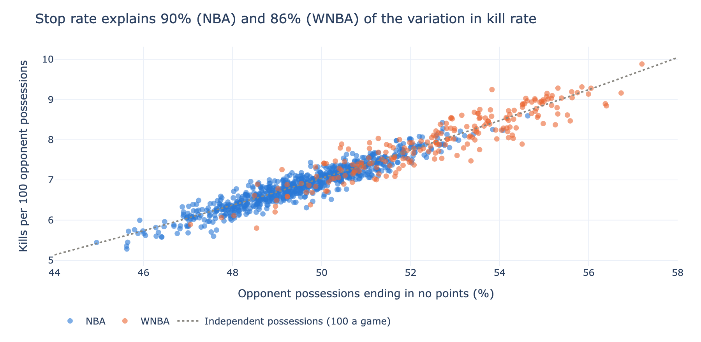
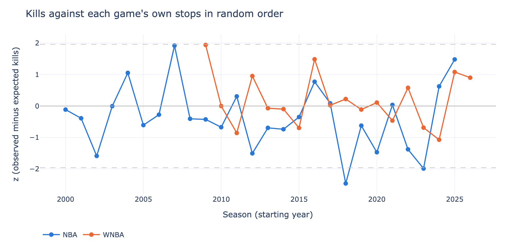

# Kills study

A "kill" is three defensive stops in a row: coach and broadcast vocabulary
with no official stat behind it. This study counts every kill in the NBA
from 2000-01 to 2025-26 and the WNBA from 2009 to 2026, ranks the team
defenses that piled them up, keeps a record book of the longest stop
streaks, and tests whether a kill measures anything a defense's stop rate
does not.

A stop is an opponent possession that scores no points. Possessions come
from the pbpstats possession archive (the two newest seasons from corrected
live-feed builds; see Results), so an offensive rebound continues a
possession rather than starting a new one; points come from the PlayByPlayV3
score timeline, assigned to the scoring team's possession. Streaks carry
across quarters and reset at the final buzzer, and a run of six straight
stops is two kills. The streakiness test compares each team-season's kills
with exact baselines from dynamic programs: one with each possession a stop
at the team's season rate, and one with each game's own stops in a random
order.

Design, decisions, and data checks: `docs/design.md`. Data sources and
licenses: `DATA_SOURCES.md`. Private repo; not yet on the family hub.

## Results

<!-- gen:results -->
Coverage: 31,197 NBA games (2000-01 to 2025-26) and 3,880 WNBA games (2009 to 2026), 6,543,543 possessions, every game whose score passes the shared layer's checks (12 such games are missing from the possession sources). Possession points capture at least 99.86% of every season's points; the rest are free throws that belong to no possession (technicals, a period's first second). Every table is computed in Python and again in R, and the two agree on every cell.

**Two possession sources.** NBA 2025-26 and WNBA 2026 are not in the pbpstats archive and come from playbyplay-study's live-feed builds, corrected two ways (empty end-of-period stubs dropped; each period-start possession given to the team that first shoots or turns it over). On the four seasons both sources cover, the corrected builds reproduce the archive's team kill rates:

| Season | Builds | Offense agrees | League kills vs archive | Team kill-rate correlation | Mean team difference (per 100) | Largest team difference |
|---|---|---|---|---|---|---|
| NBA 2023-24 | as stored | 99.24% | +7.34% | 0.9884 | +0.382 | 0.578 |
| NBA 2023-24 | corrected | 99.94% | +0.45% | 0.9977 | +0.024 | 0.091 |
| NBA 2024-25 | as stored | 99.22% | +6.43% | 0.9845 | +0.351 | 0.599 |
| NBA 2024-25 | corrected | 99.94% | +0.39% | 0.9957 | +0.029 | 0.156 |
| WNBA 2024 | as stored | 99.19% | +7.80% | 0.9904 | +0.435 | 0.638 |
| WNBA 2024 | corrected | 99.94% | +0.23% | 0.9967 | -0.018 | 0.218 |
| WNBA 2025 | as stored | 99.05% | +8.30% | 0.9706 | +0.421 | 0.800 |
| WNBA 2025 | corrected | 99.89% | +1.42% | 0.9962 | +0.022 | 0.152 |

Uncorrected, the builds would add about 0.40 kills per 100 to every team, a false jump in the newest seasons. Spread across teams is 0.47 to 0.97 per 100, for scale.

- NBA 2025-26: kills per 100 went from 6.75 to 6.51 (-0.25), against a builder difference of at most 0.029 on the overlap seasons; points per 100 opponent possessions went from 114.8 to 116.2.
- WNBA 2026: kills per 100 went from 8.01 to 7.33 (-0.67), against a builder difference of at most 0.022 on the overlap seasons; points per 100 opponent possessions went from 104.5 to 108.9.

### 1. What a kill measures beyond the stop rate

Across team-seasons, the correlation between stop rate and kill rate is 0.948 in the NBA and 0.929 in the WNBA: stop rate alone explains 90% and 86% of the variation in kill rate.

The sharper test holds each game's stops fixed and asks whether they cluster: against every ordering of a game's own stops being equally likely, how many kills should a team have had? (This baseline already absorbs opponent strength, pace, and blowouts, because it keeps each game's stop count.)

| League | Team-seasons | Kills | Excess over random order | z | Team-seasons with abs(z) > 1.96 |
|---|---|---|---|---|---|
| NBA | 776 | 407,654 | -661 (-0.16%) | -1.85 | 5.5% |
| WNBA | 221 | 48,310 | +96 (+0.20%) | +0.83 | 4.5% |

About 5% of team-seasons would pass 1.96 by chance alone; 5.5% and 4.5% do. So no team's defense strings its stops together more than its stop rate implies. The WNBA's pooled count sits at chance (z +0.83). The NBA's is slightly below it (z -1.85; 18 of 26 seasons below zero): stops alternate with scores a little more often than random order would give, by a fraction of a percent. The cause is not tested here.





### 2. Best kill rates

Kills per 100 opponent possessions; z is the same rate against that league-season's teams, and the last column is the team-season's own streakiness z (near zero means the kills came from the stop rate):

**NBA**

| Rank | Season | Team | Kills per 100 | z in season | Stop rate | Streakiness z |
|---|---|---|---|---|---|---|
| 1 | 2019-20 | MIL | 8.60 | 2.60 | 54.6% | -0.73 |
| 2 | 2000-01 | SAS | 8.43 | 2.29 | 52.7% | +2.66 |
| 3 | 2011-12 | BOS | 8.28 | 2.02 | 52.7% | +1.38 |
| 4 | 2003-04 | DET | 8.25 | 1.89 | 53.8% | -0.78 |
| 5 | 2003-04 | SAS | 8.23 | 1.86 | 54.1% | -1.44 |
| 6 | 2003-04 | NJN | 8.21 | 1.82 | 53.1% | +0.38 |
| 7 | 2003-04 | IND | 8.20 | 1.79 | 52.7% | +1.31 |
| 8 | 2015-16 | SAS | 8.13 | 2.34 | 53.4% | -0.55 |
| 9 | 2000-01 | PHI | 8.13 | 1.78 | 52.8% | +0.70 |
| 10 | 2012-13 | IND | 8.12 | 2.25 | 52.6% | +1.08 |

**WNBA**

| Rank | Season | Team | Kills per 100 | z in season | Stop rate | Streakiness z |
|---|---|---|---|---|---|---|
| 1 | 2021 | CON | 9.88 | 2.00 | 57.2% | +0.73 |
| 2 | 2012 | ATL | 9.31 | 1.38 | 55.8% | +0.53 |
| 3 | 2021 | MIN | 9.28 | 1.28 | 55.3% | +1.20 |
| 4 | 2024 | CON | 9.28 | 1.28 | 56.1% | +0.29 |
| 5 | 2012 | LAS | 9.25 | 1.29 | 53.8% | +3.03 |
| 6 | 2011 | MIN | 9.19 | 1.38 | 55.6% | +0.40 |
| 7 | 2022 | CON | 9.17 | 1.42 | 55.7% | +0.24 |
| 8 | 2020 | SEA | 9.16 | 1.38 | 56.7% | -0.92 |
| 9 | 2009 | IND | 9.15 | 1.30 | 55.1% | +0.95 |
| 10 | 2024 | MIN | 9.14 | 1.13 | 56.0% | -0.20 |

### 3. The stop-streak record book

Longest runs of opponent possessions without a point (a streak carries across quarters and ends at the final buzzer); the margin is the defense's when the streak began:

**NBA**

| Rank | Date | Defense | Opponent | Stops | From | To | Margin at start |
|---|---|---|---|---|---|---|---|
| 1 | 2006-03-01 | LAC | NOK | 22 | 7:45 Q3 | 7:50 Q4 | -7 |
| 2 | 2009-12-06 | CLE | MIL | 22 | 4:13 Q1 | 5:42 Q2 | -7 |
| 3 | 2009-11-02 | CHA | NJN | 19 | 6:26 Q3 | 8:55 Q4 | -7 |
| 4 | 2013-01-14 | CHI | ATL | 19 | 2:27 Q1 | 5:52 Q2 | +7 |
| 5 | 2021-04-27 | DAL | GSW | 19 | 8:24 Q1 | 11:37 Q2 | +1 |
| 6 | 2003-04-11 | ATL | CLE | 18 | 8:18 Q1 | 0:28 Q1 | -6 |
| 7 | 2005-11-14 | NYK | UTA | 18 | 10:28 Q3 | 1:41 Q3 | -3 |
| 8 | 2009-12-29 | CLE | ATL | 18 | 0:17 Q3 | 3:45 Q4 | +1 |
| 9 | 2015-11-25 | CHA | WAS | 18 | 9:25 Q4 | 0:47 Q4 | -9 |
| 10 | 2001-02-16 | SAC | DEN | 17 | 2:00 Q1 | 5:44 Q2 | +0 |

**WNBA**

| Rank | Date | Defense | Opponent | Stops | From | To | Margin at start |
|---|---|---|---|---|---|---|---|
| 1 | 2017-08-18 | MIN | IND | 21 | 4:37 Q1 | 4:04 Q2 | +13 |
| 2 | 2023-06-22 | IND | SEA | 21 | 3:46 Q3 | 4:13 Q4 | -1 |
| 3 | 2015-06-09 | TUL | SEA | 18 | 0:32 Q1 | 2:28 Q2 | +14 |
| 4 | 2013-08-11 | PHO | TUL | 17 | 3:37 Q1 | 4:06 Q2 | -2 |
| 5 | 2009-09-08 | IND | NYL | 16 | 8:16 Q1 | 1:45 Q1 | -6 |
| 6 | 2019-07-21 | IND | CHI | 16 | 4:30 Q1 | 7:26 Q2 | -9 |
| 7 | 2022-08-02 | CON | PHO | 16 | 3:32 Q1 | 6:40 Q2 | -3 |
| 8 | 2023-05-21 | IND | NYL | 16 | 8:41 Q4 | 0:56 Q4 | -32 |
| 9 | 2025-06-29 | MIN | CON | 16 | 0:34 Q1 | 3:02 Q2 | +8 |
| 10 | 2026-06-22 | PHX | IND | 16 | 9:09 Q1 | 0:16 Q1 | -3 |

The longest streak of every season: `output/season_records.csv`; the top 25 per league: `output/records.csv`.
<!-- /gen:results -->

## Limits

- Seasons: the pbpstats archive covers NBA 2000-01 to 2024-25 and WNBA 2009
  to 2025. NBA 2025-26 and WNBA 2026 come from a different builder (the
  pbpstats library on the liveData feed, run by playbyplay-study), corrected
  and checked against the archive on four overlap seasons (the table in
  Results). Its team kill rates differ from the archive's by a few
  hundredths of a kill per 100 on average, so a change that small into the
  newest season can be the builder rather than the game.
- Every possession counts, including end-of-quarter heaves, which are nearly
  always stops. That is how a broadcast would count, and it raises every
  team's kills about equally.
- Technical and away-from-play free throws that fall outside any possession
  are not counted against the defense; a possession on which the defense
  allows only such free throws is a stop.
- The random-order baseline assumes stops are exchangeable within a game.
  Possessions late in close games or in garbage time are not, which can push
  the observed count either way; the study does not model that.
- Margins in the record book come from summing possession points, so they can
  differ from the true score by an unassigned free throw.

## Reproduce

The events come from the family's shared PlayByPlayV3 layer
(`../basketball-analysis-tools/pbp_history.py`); the possession archive is
downloaded by the same module.

```bash
python python/01_possessions.py   # possessions with points, validation
python python/02_kills.py         # kills, baselines, records, leaders
Rscript R/kills.R                 # the same, independently, in R (~2 min)
python python/03_reconcile.py     # Python against R, every cell
python python/06_source_check.py  # live builds against the archive, four seasons
python python/04_figures.py       # figures/
python python/05_report.py        # this README's results
bash run_checks.sh                # every gate
```

Raw play-by-play stays local (NBA.com terms); `output/` holds team-season
aggregates and the record tables only.
